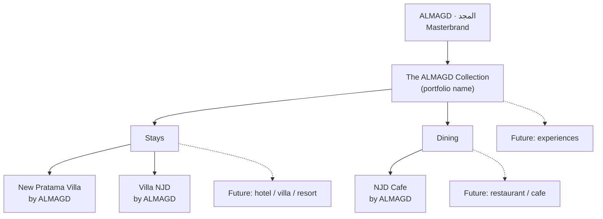

# BRAND ARCHITECTURE

Implements DEC-002, DEC-003, DEC-004.

## Model: Endorsed brands
- **ALMAGD** owns the site identity: domain, header logo, footer, colours, typography, voice.
- **Venue names** remain as known on OTAs/social. They appear in the site's typography (no separate venue logos at launch).
- **Endorsement line** under each venue name: "by ALMAGD" (EN/ID) · "من المجد" (AR).
- Group descriptor: "The ALMAGD Collection" / "Koleksi ALMAGD" / "مجموعة المجد".

## Lockup rules
| Context | Format |
|---|---|
| Venue page hero eyebrow | `THE ALMAGD COLLECTION` (small caps, tracking +8%; AR no tracking) |
| Venue name | Display font, e.g. "Villa NJD" |
| Endorsement | Body small, muted: "by ALMAGD" |
| Cards | Venue name + type label ("Villa · Cisarua") — no endorsement needed (context implies) |
| Footer | ALMAGD wordmark + list of venues |
| Schema | Organization ALMAGD → `subOrganization` / venue `parentOrganization` |

## Naming rules for future venues
1. Keep existing venue name if it has market equity; else "[Name] by ALMAGD".
2. Never prefix ALMAGD into an existing venue name.
3. Type label from fixed list: Villa · Hotel · Resort · Restaurant · Cafe · Experience.
4. Slug = kebab-case of display name, permanent.

## Do / Don't
- ✅ "Villa NJD — by ALMAGD"   ❌ "ALMAGD Villa NJD"
- ✅ "New Pratama Villa"       ❌ "New Pratama Resort" (unless owner confirms)
- ✅ "NJD Cafe"                ❌ "NJD Restaurant & Lounge"
