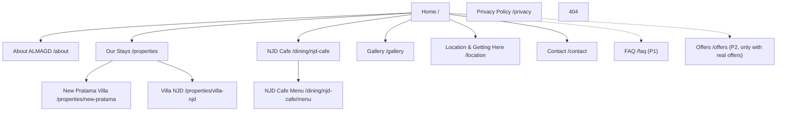

# SITEMAP

> **Single Source of Truth for: page structure.** URLs → [URL-STRUCTURE.md](./URL-STRUCTURE.md) · Page specs → [07-PAGE-SPECS](../07-PAGE-SPECS/) · Decisions DEC-008, DEC-009.

## Page tree

| Level | Page | Path (id locale) | Priority | Template | In main nav? | Spec |
|---|---|---|---|---|---|---|
| 0 | Home | `/` | P0 | `home` | Logo | [HOME.md](../07-PAGE-SPECS/HOME.md) |
| 1 | About ALMAGD | `/about` | P0 | `about` | Yes ("About") | [ABOUT.md](../07-PAGE-SPECS/ABOUT.md) |
| 1 | Our Stays (properties index) | `/properties` | P0 | `property-index` | Yes ("Stays", dropdown) | [PROPERTIES.md](../07-PAGE-SPECS/PROPERTIES.md) |
| 2 | New Pratama Villa | `/properties/new-pratama` | P0 | `property` | Dropdown | [NEW-PRATAMA.md](../07-PAGE-SPECS/NEW-PRATAMA.md) |
| 2 | Villa NJD | `/properties/villa-njd` | P0 | `property` | Dropdown | [VILLA-NJD.md](../07-PAGE-SPECS/VILLA-NJD.md) |
| 1 | NJD Cafe | `/dining/njd-cafe` | P0 | `restaurant` | Yes ("Dining") | [NJD-CAFE.md](../07-PAGE-SPECS/NJD-CAFE.md) |
| 2 | NJD Cafe Menu | `/dining/njd-cafe/menu` | P0 | `menu` | Via Cafe page + footer | [NJD-CAFE-MENU.md](../07-PAGE-SPECS/NJD-CAFE-MENU.md) |
| 1 | Gallery | `/gallery` | P0 | `gallery` | Yes | [GALLERY.md](../07-PAGE-SPECS/GALLERY.md) |
| 1 | Location & Getting Here | `/location` | P0 | `location` | Yes ("Location") | [LOCATION.md](../07-PAGE-SPECS/LOCATION.md) |
| 1 | Contact | `/contact` | P0 | `contact` | Yes (+ header CTA) | [CONTACT.md](../07-PAGE-SPECS/CONTACT.md) |
| 1 | Privacy Policy | `/privacy` | P0 | `legal` | Footer only | (in [PRIVACY-REQUIREMENTS.md](../12-TECHNICAL-PLANNING/PRIVACY-REQUIREMENTS.md)) |
| — | 404 Not Found | `/404` | P0 | `error` | No | [FOOTER.md](../07-PAGE-SPECS/FOOTER.md) §404 |
| 1 | FAQ | `/faq` | P1 | `faq` | Footer | [FAQ.md](../07-PAGE-SPECS/FAQ.md) |
| 1 | Offers | `/offers` | P2 | `offers` | Only when ≥1 live offer | [OFFERS.md](../07-PAGE-SPECS/OFFERS.md) |
| global | Header, Footer, Floating WhatsApp | — | P0 | layout | — | [NAVIGATION.md](./NAVIGATION.md), [FOOTER.md](../07-PAGE-SPECS/FOOTER.md) |

Each page exists in 3 locales (`/`, `/en/`, `/ar/`) per DEC-012/DEC-013 → **12 P0 pages × 3 = 36 URLs**.

## Deliberately NOT included (and why)

| Candidate | Decision | Reason |
|---|---|---|
| `/dining` index | Not built; `/dining` → 301 to `/dining/njd-cafe` | Only one venue. Build index when 2nd F&B venue exists |
| Separate room pages | No (DEC-009) | Thin content |
| Experiences page | No | No owned experiences; Puncak attractions covered on `/location` |
| Blog | No | No content team; risk of thin AI content |
| Booking page | No (DEC-001) | Not a booking engine |
| Careers / Investors | No | No data |
| Offers at launch | No (DEC-008) | No offers exist — MISSING_CONTENT |

## Expansion rule (future venues)

Adding a venue = add one data file in the right collection (`properties` or `dining`) + images → page, cards, nav dropdown, sitemap.xml, schema and gallery filter are generated automatically. Types allowed: `villa`, `hotel`, `resort`, `restaurant`, `cafe`, `experience`. When a 2nd dining venue exists, enable `/dining` index page.
