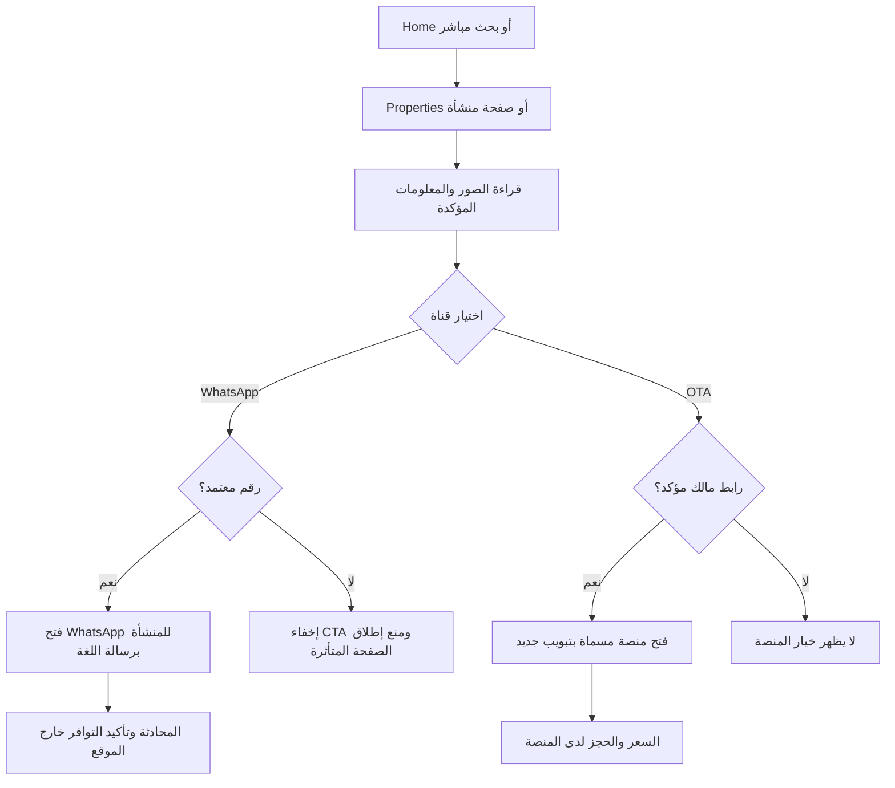
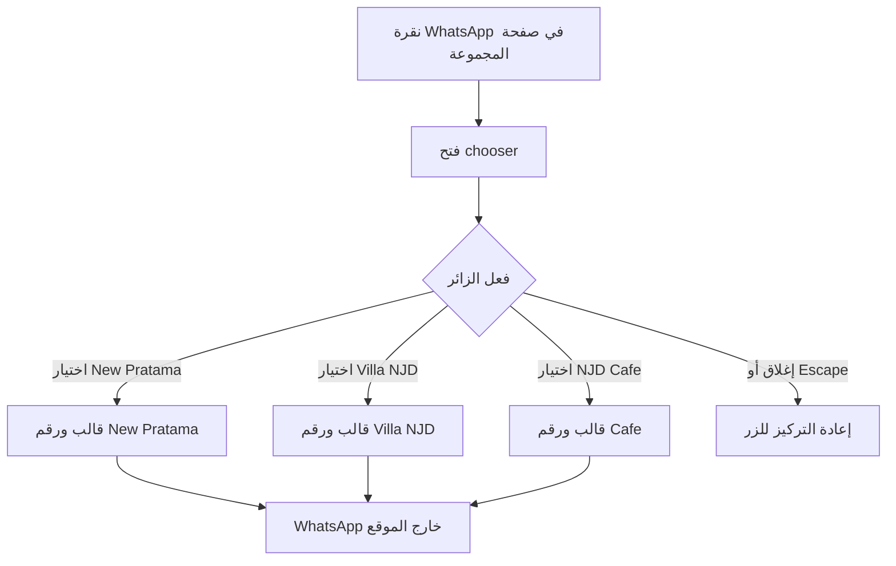
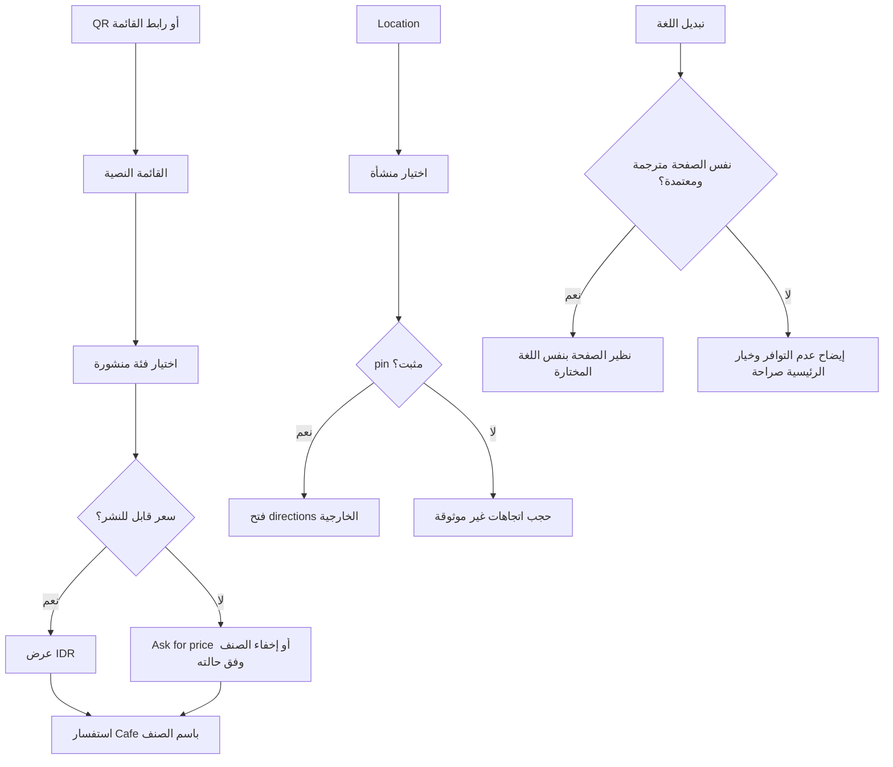

# تدفقات الاستخدام

هذه مخططات Mermaid للمواصفات فقط بطلب المستخدم؛ لا كود موقع أو نموذج بيانات تنفيذي. مرجع DEC-010/012/023/024، [CTA-COPY](../05-CONTENT/CTA-COPY.md).

## اختيار إقامة والتواصل

## الزر الجماعي واختيار المنشأة

خيارات غير مؤكدة لا تتحول إلى رقم بديل؛ Preview يوضح نقصها للمراجع فقط. لا click_whatsapp عند فتح chooser أو إغلاقه.

## القائمة والموقع واللغة

## فشل الانتقال

WhatsApp غير مثبت: رابط الويب أو رقم الهاتف المعتمد يبقى وسيلة يختارها المستخدم؛ لا اكتشاف تطبيقات أو إعادة توجيه تلقائي. OTA معطل: يرجع المستخدم إلى الصفحة الموجودة ويختار WhatsApp؛ لا بديل صامت إلى منصة أخرى. Maps لم يُحمّل: العنوان ورابط الخرائط مستقلان عن embed. JavaScript غير متاح: روابط الصفحات والقائمة والاتصال المباشر تعمل؛ بديل chooser رابط /contact.

قبول: كل فرع لديه حالة واضحة وعودة؛ لا فرع ينتهي بدفع أو حجز داخلي؛ لا تشغيل بأي PLACEHOLDER.
